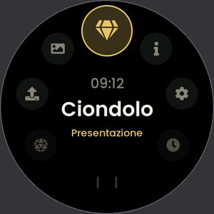
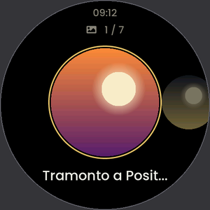
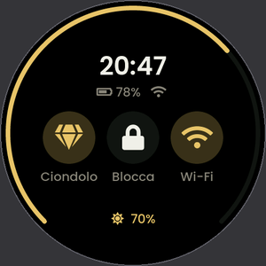
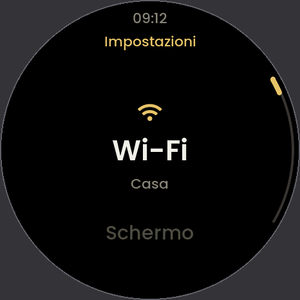
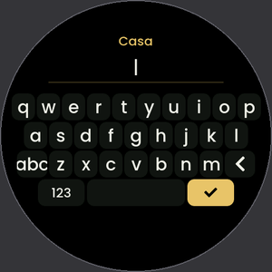
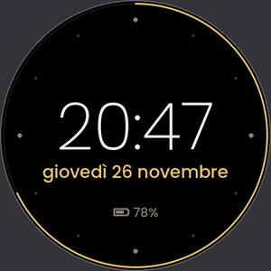
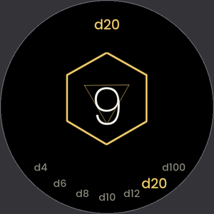
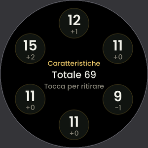

# AmuletOS

**A wearable pendant for the Waveshare ESP32-S3-Touch-AMOLED-1.75**: a round 466×466 AMOLED
screen worn as a necklace that shows your photos, GIFs and videos. Media are sent from the
phone over Wi-Fi, cropped to the circle right in the browser. Comes with a launcher designed for
the round screen, gesture controls with a virtual bezel, Wi-Fi setup from the phone and
over-the-air updates from the GitHub releases.

<p>




</p>

*Screenshots from the simulator (`tools/sim`), outside the circle there is no screen.*

## Hardware

- [Waveshare ESP32-S3-Touch-AMOLED-1.75](https://www.waveshare.com/esp32-s3-touch-amoled-1.75.htm)
  (also the -B and -G variants): ESP32-S3R8 (8 MB PSRAM), 16 MB flash, CO5300 AMOLED,
  CST9217 touch, AXP2101 PMU, PCF85063 RTC, QMI8658 IMU, microSD slot.
- A **microSD card formatted FAT32**: the media live there.
- A LiPo battery on the board's battery connector for wearing it.
- An enclosure that leaves both buttons (**BOOT** and **PWR**) reachable.

The GPS of the -G variant is not used yet: it is kept in reset (Settings › System › GPS).

## Install

### First time: over USB

1. **Web installer** (Chrome or Edge on a computer): open the GitHub Pages site of this
   repository, connect the board by USB and press *Connect & install*. The site is published by
   the CI at every push to `main` (once: *Settings › Pages › Source = GitHub Actions*).
2. **Or esptool**, with `amulet.bin` from the [latest release](https://github.com/raxp122/ESP32-S3-1.75inch-Amoled-GPS-Gadget/releases/latest):

   ```bash
   esptool.py --chip esp32s3 write_flash 0x0 amulet.bin
   ```

If the computer does not see the board: another USB cable (many only charge), or hold BOOT while
plugging it in.

### Afterwards: over Wi-Fi

Every push to `main` builds a release (`0.1.<build>`). The pendant checks for it when it gets
internet (it shows a notice) and installs it from **Settings › Updates › Firmware** (tap to
check, tap twice to install). A new firmware that fails to start rolls back to the previous one
by itself. Settings sit at the end of the flash and media on the microSD: updates never touch them.

## First start

1. Insert the microSD card.
2. **Wi-Fi**: Settings › Wi-Fi › **From your phone**. The pendant opens a hotspot
   (`AmuletOS-XXXX`) and shows a QR code: scan it, the setup page opens by itself, pick your
   network and type the password. Alternatively Settings › Wi-Fi › Network lists the networks and
   shows a keyboard on the round screen.
3. **Upload**: open *Upload* on the pendant and scan the QR code with the phone (same Wi-Fi).
   Enter the 4-digit PIN shown on the pendant, choose photos, GIFs or videos, drag and pinch to
   frame them in the circle and send. Without Wi-Fi the pendant opens its own hotspot and the QR
   code joins it first.
4. **Wear it**: press **BOOT** on the home screen, or tap a media in the *Gallery*.

## Controls

The interface is made for a round screen: the current item sits in the middle, the edge works
like the bezel of a watch.

| Gesture | Action |
|---|---|
| Slide along the edge (virtual bezel) | turn the launcher ring (the icons follow the finger), scroll lists and the gallery, change values |
| Swipe up / down | next / previous item |
| Swipe left | next item (gallery, launcher) |
| Swipe right | back |
| Tap | open / select; in lists tap the item above or below to move to it |
| Double tap | gallery: slideshow starting from this media |
| Long press | gallery: actions (show, slideshow from here, delete) |
| Swipe down from the top edge | quick panel: brightness on the bezel, pendant, lock, Wi-Fi |

| Button | Action |
|---|---|
| **BOOT** | back; on the home screen: pendant mode; in pendant mode: next media |
| **BOOT** held 2 s | home; in pendant mode: leave it (a ring shows the progress) |
| **PWR** | screen off and **locked** (touch and BOOT ignored) / screen on |
| **PWR** held 5 s | power off (red countdown ring); PWR turns it on again |

On USB power the PMU keeps the board running after a power off: unplug the cable.
After 10 s the AXP2101 cuts the power on its own, even if the firmware is stuck.

### Pendant mode

Full screen, the touch is off (it rubs against clothes), only the buttons work:
**BOOT** = next media, **BOOT held 2 s** = back to the menus, **PWR** = screen off/locked.
Either **one media in a loop** (tap in the gallery) or a **slideshow** (double tap, or *Slideshow
from here*). Settings › Pendant:

- *Brightness* of the pendant (separate from the menus)
- *Interval* of the slideshow (5 s to 30 min) and *Shuffle*
- *Screen off after* (never, 5 min to 4 h) and *Wake on movement*: the timer counts from the last
  movement (IMU) and moving wakes the screen again
- Settings › **Night**: from/to hours, dimmed or screen off at night (a button press keeps it on
  for a minute)

<p>




</p>

### Launcher

The apps sit on a ring along the edge, the selected one at 12 o'clock. At 6 o'clock two
small strokes mark a horizon: apps sliding towards it fade out and new ones come in from the
other side, so the list has room for any number of apps. Settings › Screen › **App list**:
*Loops* (after the last app comes the first again) or *Stops at the ends* (at the first or last
app that half of the circle stays empty).

## Apps

- **Pendant**: pendant mode with the last setup.
- **Gallery**: round previews of the media on the card.
- **Upload**: QR code, address and PIN of the upload page (the server only runs while it is open).
- **Dice**: tabletop dice for D&D, see below.
- **Clock**: time from the internet (NTP), kept by the RTC.
- **Settings**: Wi-Fi, screen (brightness, rotation 0/90/180/270 for how the board sits in the
  case, accent colour, auto off), pendant, night, updates, language (Italian / English), time
  zone, system.
- **Info**: battery, power, microSD, network, firmware, memory.

## Dice

<p>


</p>

| Gesture | Action |
|---|---|
| Tap / shake the pendant | roll (the die tumbles, then lands) |
| Bezel (the selection follows the finger along the lower edge), or tap a die there | d4, d6, d8, d10, d12, d20, d100 |
| Swipe up / down | more / fewer dice (1 to 20) |
| Swipe left | normal → advantage → disadvantage (d20: roll twice, keep the higher / lower) |
| Long press | options |

A natural 20 turns gold, a natural 1 red. With several dice (or advantage) the single dice are
listed under the total, discarded ones in brackets. Options: number of dice, modifier (−20 to
+30), roll mode, **saved rolls** (up to 6, e.g. "8d6" for a fireball), **ability scores**
(4d6 drop the lowest, six times, with the D&D modifiers; tap to roll again), **history** of the
last 30 rolls, shake to roll on/off. Rolls use the ESP32's hardware random generator without
modulo bias.

## Battery

Made for a small cell (default 500 mAh, set the real capacity in Settings › Battery):

- **Charger** at about 0.5 C for the set capacity; *Charge to 90 %* stops at 4.1 V instead of
  4.2 V, kinder to the cell.
- **Protection**: warnings at 15 % and 7 %; at 3 % (and below 3.55 V) the pendant switches itself
  off, leaving the cell its reserve. The PMU also cuts the power below 3.2 V on its own.
- **Power saving** (on by default): the CPU runs at 80 MHz and goes into light sleep whenever
  nothing is happening, 240 MHz only while drawing or decoding. The AMOLED keeps a still picture
  on its own, so a photo in pendant mode costs little more than the screen. With the screen off
  the panel sleeps too. Off on USB power (the serial link would drop) and when the setting is off.
- **Wi-Fi only when needed** (on by default): the home connection pauses in pendant mode and
  after a minute with the screen off; it comes back by itself in the menus.
- Inputs are polled less often when only the buttons matter (pendant mode, screen off).

What uses most is the screen itself (brightness and how much of the picture is lit: black is
free on an AMOLED) and animations, which decode JPEG frames all the time.

## Media formats

The phone does the heavy work, the pendant only stores and plays files:

| On the phone | On the card (`/amulet`) |
|---|---|
| Photo (JPEG, PNG, HEIC...) | `name.jpg`, 466×466, cropped to the circle |
| GIF | `name.amj`, every frame as a JPEG with its own delay |
| Video (MP4, MOV, WebM...) | `name.amj`, 10-24 fps, up to 60 s, no audio |

Plus a 240×240 preview in `/amulet/.thumb/`. **AMJ** ("Amulet Motion JPEG") is a tiny container:
a 16-byte header (`AMJ1`, width, height, frame count), an index of `{offset, size, delay_ms}` per
frame and the JPEG frames (see `main/core.h`). Frames are decoded with Espressif's SIMD JPEG
decoder (`esp_new_jpeg`) and sent straight to the panel; the target is 15-20 fps at full
screen (not measured on the board yet).

Files can also be copied onto the card by hand (`.jpg` at 466×466, `.amj`): the gallery makes
the preview itself when there is none.

## Build

ESP-IDF **5.4.2**, target `esp32s3`.

```bash
sh tools/fetch_deps.sh      # LVGL 9.2.2 and esp_new_jpeg into components/ (not kept in git)
```

```bash
idf.py set-target esp32s3 && idf.py build
```

```bash
idf.py -p /dev/ttyACM0 flash monitor
```

Flashing from `idf.py` writes the partition table and the app; the settings (NVS at the end of
the flash) stay.

### Tests, simulator, mock device

```bash
make -C tests               # native tests of the pure logic (main/core.c)
```

```bash
sh tools/sim/run.sh         # the real screens on the PC: tools/sim/out/*.png + layout-report.md
```

```bash
python3 tools/mock_device.py   # the upload page on http://localhost:8466 (PIN 1234), no board needed
```

The simulator compiles LVGL and the real UI code with fake hardware (`tools/sim/stubs.c`) and
checks that no text leaves the circle. It needs one `idf.py build` first (for the LVGL
configuration) and Python with Pillow.

## Project layout

| Path | What |
|---|---|
| `main/board.*` | I2C chips: PMU, IO expander (PWR button), RTC, IMU, touch reset |
| `main/display.*` | CO5300 over QSPI, LVGL task, rotation, direct frames for the player |
| `main/input.*` | touch gestures (swipes, taps, long press, bezel, pull-down) and buttons |
| `main/ui.*`, `main/menu.c` | screen stack, overlays, power/lock, the round menu |
| `main/apps/` | home, gallery, pendant (player), upload, clock, settings, Wi-Fi, keyboard, OTA, quick panel, info |
| `main/media.*`, `main/core.*` | media library, JPEG decoding, AMJ format (pure logic in `core.c`, tested) |
| `main/web.*`, `main/www/` | web server and the upload / Wi-Fi pages served by the pendant |
| `main/wifi_mgr.*`, `main/ota.*` | Wi-Fi, hotspot with captive DNS, NTP; updates from GitHub |
| `main/i18n.*` | texts in Italian and English |
| `web/` | web installer (GitHub Pages) |
| `tools/` | fonts, dependencies, simulator, mock device |

## Roadmap

- GPS app for the -G variant (position, speed, compass)
- More apps in the launcher, watch faces as pendant content
- Lower power in pendant mode (light sleep between frames of still images)

## Credits

- Board support, display and touch sequences, Wi-Fi and OTA logic adapted from
  [raxp122/ESP32-Developement](https://github.com/raxp122/ESP32-Developement).
- [LVGL](https://lvgl.io) (MIT), [esp_new_jpeg](https://github.com/espressif/esp-adf-libs/tree/master/esp_new_jpeg)
  (Espressif MIT), [Poppins](https://fonts.google.com/specimen/Poppins) (SIL OFL, `tools/fonts/OFL.txt`),
  Font Awesome 5 Free icons shipped with LVGL, [ESP Web Tools](https://esphome.github.io/esp-web-tools/).

License: MIT (see `LICENSE`).
